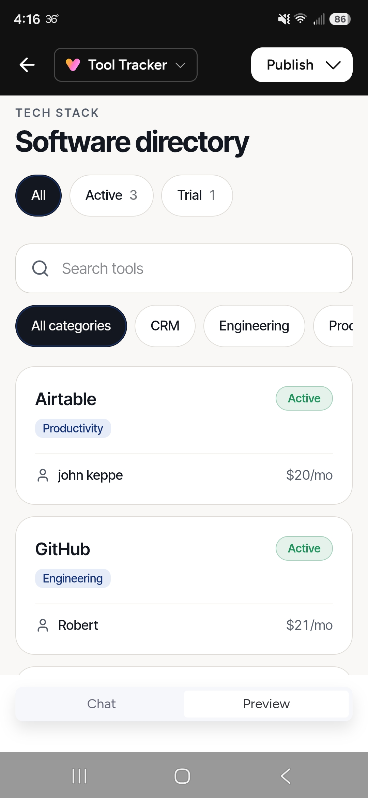

# Hi there, I'm John Keppe 👋

### **Administrative Professional & Operations Technology Specialist**
*Bridging traditional administrative excellence with modern automation, AI workflows, and cloud-based business systems.*

---

### 🛠️ Technical Toolkit & Skills
* **Operations & Systems:** Airtable, monday.com, Notion, Google Workspace, Microsoft 365.
* **Automation & AI:** AI Agent Configuration & Orchestration, Prompt Engineering.
* **Development & Version Control:** GitHub, Beginner JavaScript (Variables, Arrays, Objects, JSON parsing).
* **Core Competencies:** Database Management, Process Improvement, Business Process Automation (BPA), Records Management.

---

# 🚀 Featured Operational Projects

### 1. airtable-notion-sync
Built and deployed an automated Python sync script (sync.py) that syncs job application records from an Airtable "Companies" table into a Notion "Applications" database and writes back metadata (Notion Page ID, Notion URL, and a "Synced to Notion" flag) to prevent duplicate entries.

**Key details & setup:**
* ***Cloud & Mobile Workflow:*** Hosted on an Oracle Cloud Free Tier Ubuntu VM (VM.Standard.E2.1.Micro) and configured/maintained via SSH from a mobile phone using Termux.
* ***Scheduling & Logging:*** Configured to run hourly via cron with output logged to sync.log, plus environment secrets kept local using .env and excluded via .gitignore.
* ***Field Mapping & Troubleshooting:*** Maps job fields (Job Title, Company, Location, Salary, Status, Job URL, and Date Applied) across REST APIs, including catching and adapting to exact Notion schema property names (such as a trailing space on "Date Applied ").

>[!NOTE]
>**Honest note & huge shoutout to AI:**
>I built this iteratively with AI guidance as a practical learning and workflow project, validated on a small personal dataset with one-way creation and targeted write-back rather than full two-way conflict resolution. Huge shoutout to AI for helping me turn a phone-and-cloud idea into working code, debug API and Git steps along the way,and document it on GitHub.

Repo: Check out the [airtable-notion-sync repository](https://github.com/keppejh/airtable-notion-sync)

### 2. 🏢 Internal Tech Stack & License Tracker (`monday.com`)
* **Overview:** Designed a centralized mobile-optimized tracking system in monday.com to manage company software sprawl, monitor vendor contracts, track monthly costs, and assign software owners.
* **Key Features Built:**
  * Categorized groups for *Active Core Tools*, *Departmental Tools*, and *Evaluating/Deprecating*.
  * Custom column schemas mapping status, spend, renewal dates, and department ownership.
  * Configured certified monday.com digital agent automations to streamline software triage and team notifications.

### 3. # Mobile Software Directory & Tech Stack Tracker 📱

> **Platform:** monday.com Work OS (Vibe App Framework)  
> **Repository:** [github.com/keppejh/monday-mobile-software-directory](https://github.com/keppejh/monday-mobile-software-directory)  
> **Status:** Prototyped & Functional (Unpublished due to workspace plan tier)

---

#### 🌟 Overview
The **Mobile Software Directory** is a touch-friendly, responsive mobile application built using the **monday.com Vibe** framework. Designed to solve internal software sprawl and eliminate visibility bottlenecks, it empowers team members to browse company software, identify departmental tool owners, monitor monthly recurring costs, and verify subscription statuses in seconds.

---

#### ✨ Key Capabilities
* **Real-Time Search:** A sticky search bar at the top of the screen allows users to instantly filter through every software tool by name while scrolling.
* **Dynamic Category Filtering:** Horizontally scrollable category filter chips (e.g., *CRM*, *Engineering*, *Productivity*) are dynamically derived server-side from all categories present on the underlying monday.com board.
* **Glanceable Status Indicators:** Quick-filter pills at the top show live counts (e.g., *All*, *Active*, *Trial*), while individual item cards display color-coded status pills:
  * 🟢 **Green:** Active
  * 🟡 **Yellow:** Trial
  * 🟠 **Orange:** Under Review
  * 🔴 **Red:** Cancelled
* **Ownership & Spend Transparency:** Each tool card cleanly displays the software name, category tag, assigned departmental owner (defaulting to *"Unassigned"* if blank), and monthly subscription cost (e.g., `$20/mo`).
* **Paginated Loading:** Built-in pagination ("Load more") fetches the next 25 tools on demand to keep mobile performance fast and lightweight.

---

#### 🏗️ Architecture & Data Schema
This application pulls live relational data directly from a backing monday.com board (**Tool Tracker**) structured with the following schema:

| Field / Column | monday.com Column Type | Purpose |
| :--- | :--- | :--- |
| **Tool Name** | Item Name | Name of the software application (e.g., *Airtable*, *GitHub*) |
| **Status** | Status | Subscription lifecycle state (*Active*, *Trial*, *Under Review*, *Cancelled*) |
| **Category** | Text / Dropdown | Departmental or functional classification (*Productivity*, *Engineering*, *CRM*) |
| **Owner** | People | Departmental lead or admin responsible for the license |
| **Monthly Cost** | Numbers | Recurring monthly subscription spend (`$/mo`) |

---

#### 🎨 UI/UX Design Principles
* **Mobile-First Layout:** Single-column card architecture built specifically for thumb-friendly mobile navigation.
* **High Accessibility:** Crisp typography with high-contrast text, generous row padding, and clear visual hierarchy so critical metadata can be scanned at a glance.

### 4. 📊 Personal Job Search & Application Tracker (`Airtable`)
* **Overview:** Built a relational tracking application to streamline career operations, organizing target organizations, active applications, interview pipelines, and networking contacts.
* **Key Features Built:**
  * Clean single-table operational layout tracking status, dates, and follow-up schedules.
  * Custom grouping and filtering views to prioritize active outreach and manage interview milestones.
 
### 5.⚡ Cyberpunk Weather Pipeline & Self-Healing Alert System

A lightweight, automated daily intelligence pipeline that fetches weather data, formats it with a stylized cyberpunk theme, and delivers it daily—complete with automated error handling and self-healing alert notifications.

Check out the [weather-pipeline repository](https://github.com/keppejh/weather-pipeline)

---

### 💼 Professional Background Highlights
With **12 years of administrative experience** across student services, banking, retail operations, and seasonal tax preparation, I bring strong foundational habits in confidentiality, accuracy, and process execution—now amplified by modern low-code tooling and AI workflow design.

* **Administrative Support & Documentation:** Streamlined internal communications, scheduling, and records management.
* **Process Improvement:** Applying structured problem-solving (Lean Six Sigma White Belt) to eliminate workflow bottlenecks.

---
📫 **Let's Connect:** [LinkedIn Profile](https://www.linkedin.com/in/keppedaemon) | 📧 jknotitia@gmail.com
